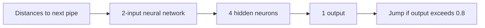

# Flappy Bird AI

I built a Flappy Bird simulation in C# with a small neural network for each bird and a genetic-learning experiment. The game renders 200 birds at once, so I can watch their decisions against the same moving obstacles.

## Demo

https://github.com/user-attachments/assets/41f2ebf1-8cd5-4da5-b441-255af583a9ff

https://github.com/user-attachments/assets/570e88b6-70c0-4a76-96ff-d5079147f44f

These are the recordings already included in this repository. They are historical demos, not a new benchmark of the current checkout.

## Inside the project

- Each bird receives two inputs: horizontal distance to the next pipe and vertical distance to its gap.
- A **2 → 4 → 1** network uses `tanh` activations. An output above `0.8` triggers a jump.
- `GeneticAlgorithm.cs` implements neuron-level crossover, weight/bias mutation, and reinitialization.
- MonoGame handles rendering, obstacle movement, and collisions. The graphics are drawn from a one-pixel texture rather than a sprite pack.

## Evolution loop

Each bird receives one fitness point for every update it survives. When all 200 birds have died, the population is sorted by that survival score: the top 10% remain, the middle 80% receive crossover and mutation from a top performer, and the bottom 10% are reinitialized. The next generation then starts from the same initial obstacle setup.

The window title shows the current generation, the best survival score from the completed generation, and the current score. This makes it possible to inspect each generation without changing the network or obstacle model.



## Run locally

The application targets **.NET 6** and **MonoGame DesktopGL 3.8.1.303**. The repository includes its content-builder tool configuration. Use the existing .NET SDK and a desktop environment with the native libraries required by MonoGame.

From the repository root:

```sh
dotnet restore "Flappy Bird/Flappy Bird.csproj"
dotnet run --project "Flappy Bird/Flappy Bird.csproj" -c Release
```

The simulation starts automatically. Press **Escape** to exit.

## Current limitations

This is an early learning project. It does not yet use reproducible seeds, saved models, or a benchmark suite. Fitness measures survival updates within this simulation, so a high score is not a general machine-learning result.

The Debug build passed during a local macOS check. A graphical run started locally; a new recording will be added only after a sustained run is captured and reviewed.

## Code guide

| File in `Flappy Bird/` | Responsibility |
| --- | --- |
| `Game1.cs` | Population, game loop, pipes, rendering |
| `Bird.cs` | Inputs, jump decision, collision handling |
| `NeuralNetwork.cs`, `Layer.cs`, `Neuron.cs`, `Dendrite.cs` | Network implementation |
| `GeneticAlgorithm.cs` | Crossover and mutation |
